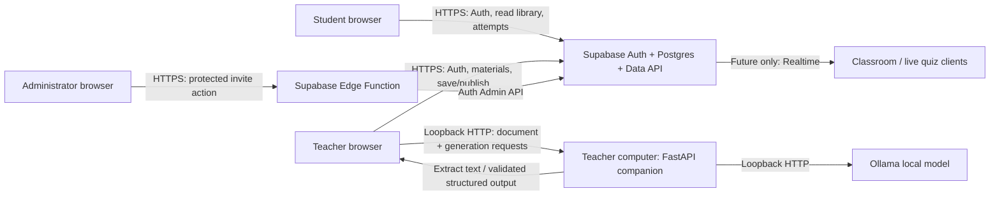

# FlashClass — Initial Architecture

## Repository findings and assumptions

The repository currently contains only `.kilo/plans/`; there is no application code, established framework, or project convention to preserve. This design therefore starts from a clean architecture.

Decisions confirmed: signup creates student accounts; administrators grant teacher capability and may invite teachers; teachers publish reviewed learning materials to a library open to signed-in users; teacher-side generation uses local Ollama through a FastAPI companion. Student-side AI generation and cloud AI keys are not in the first release. Students may optionally set an editable grade preference (grades 1–12 or Other); it personalizes recommendations only and never blocks higher-grade content. School-subject materials use one primary grade label; English uses CEFR levels A1–C2 only; non-school topics use Beginner, Intermediate, Advanced, or Expert. The first release UI supports Bulgarian and English; Bulgarian requires Cyrillic support, and learning content can be authored in any language. Bulgaria is the initial market; Supabase Central EU (Frankfurt) is the preferred database region, subject to deployment-time verification. Students may bookmark shared materials without folders. Student profiles, attempts, scores, and progress remain private; public profile visibility and leaderboards are deferred. The shared library prohibits adult-only material, but this is a content policy—not age verification or a guarantee that unsuitable material cannot be published. Teachers review before publishing; students can report content and admins can unpublish it. Assumptions: one shared service (not school/tenant isolated), desktop-first teacher AI workflows, email/password auth, and no storage of source documents. School-class membership, student generation, cloud AI, and live multiplayer are out of scope for the first release.

## 1. System architecture

Keep the system as a React web client, Supabase managed backend, and optional teacher-local companion. No general-purpose application server or microservices are needed.



- **React + TypeScript (Vite):** UI, session-aware routing, forms, quiz attempt experience, local draft editing, and API calls. It never contains a privileged database key or trusts the browser to enforce access.
- **Supabase Auth:** user credentials, sign-in, recovery, and session tokens. Passwords remain managed by Auth, not copied into application tables.
- **Supabase Postgres + Data API:** canonical profiles, roles, materials, questions, attempts, and server-side grading. Browser requests use the public/publishable key plus the signed-in user's JWT; Postgres grants and RLS authorize each operation.
- **Supabase Edge Function (narrow use):** teacher invitation/admin provisioning only, because Auth admin invites require privileged credentials. Verify the caller's admin role server-side before using the secret key. Do not build a general API layer for ordinary CRUD.
- **FastAPI companion + Ollama:** opt-in, local-only AI and document extraction on the teacher's computer. It is not part of the hosted application and is never required to browse or take quizzes.
- **Supabase Realtime:** deliberately unused in the first release. Later it can carry room presence/leaderboard events; durable quiz data and authorization remain in Postgres.

## 2. Frontend organization

Use a feature-oriented structure so related UI, validation, and data access stay together. Avoid adding a global state framework until real needs arise.

```text
src/
  app/                 app bootstrap, router, session provider, route guards
  components/          shared buttons, dialogs, form controls, loading/error UI
  i18n/                Bulgarian/English message catalogs and locale selection
  features/
    auth/               sign-up, sign-in, reset, session actions
    library/            published material browsing and filters
    materials/          teacher editor, draft/save/publish flows
    quizzes/            taking a quiz, submitting answers, results/progress
    ai/                 companion connection, generation form, review/edit UI
  lib/                  Supabase client, environment parsing, shared validators
  types/                shared domain and generated Supabase database types
```

Keep feature-specific components and hooks with their feature; keep shared UI genuinely generic. UI copy is localized in Bulgarian and English; set document language from the selected locale and ensure font/input choices render Cyrillic correctly. Both are left-to-right; use normal responsive layout without adding RTL support until a right-to-left language is actually in scope. Use React Router for pages, ordinary React state for local workflows, and the Supabase JS client for Auth and data access. Generate TypeScript database types from migrations/schema rather than maintaining a second handwritten schema. Validate AI output at runtime before displaying or saving it. Route guards improve usability only; database RLS is the security boundary.

## 3. Backend and database proposal

Use UUID primary keys, UTC timestamps, foreign keys, explicit `not null`/check constraints, and indexes on ownership, status, and foreign-key columns used in RLS or common queries. Keep application tables in `public` only when intended for the Data API. Put grading answer keys and narrowly privileged functions in a non-exposed schema.

| Table | Purpose and core relationships |
|---|---|
| `profiles` | `user_id` primary key references `auth.users(id) ON DELETE CASCADE`; display name, optional `grade_preference` (`1`–`12` or `other`), and timestamps. Grade is editable and used only for recommendations; it never restricts access. One profile per Auth user; no password or editable role field. Create profile through a trusted Auth trigger or controlled signup flow. |
| `user_roles` | `(user_id, role)` primary key; role constrained to `student`, `teacher`, or `admin`. Default student grant at signup. Admin-only trusted function/Edge Function changes roles. Keep authorization out of user-editable metadata. |
| `learning_materials` | Owner FK to `auth.users`; title, description, `kind` (`quiz`, `flashcards`, `practice_test`, `study_guide`), subject/category, status (`draft`/`published`/`archived`/`hidden`), visibility (`private`/`shared`), suitability metadata, schema version, structured `content` for non-question material, timestamps. All four kinds are in the first-release scope. Public material requires a non-adult-content teacher attestation and direct teacher publication; students can report published items and admins can hide/unpublish them. School subjects use one primary grade tag; English uses CEFR A1–C2; non-school topics use Beginner/Intermediate/Advanced/Expert. Grade is discovery metadata only—not an access limit. |
| `material_questions` | Material FK with cascade delete; stable order/position, prompt, question type (`single_choice`, `multiple_select`, `true_false`, `short_answer`), options JSON where applicable, and teacher-defined accepted answer(s) stored separately from student-readable fields. Unique `(material_id, position)`; constrain supported types and validate content shape. |
| `question_answer_keys` (private schema) | Question FK and correct answer/accepted answer data. Not exposed to the Data API or student reads. Quiz submission/grading function alone reads it. |
| `quiz_attempts` | Student FK, material FK, start/submit timestamps, status and server-computed score. Student can create and read own attempts; cannot set or edit score. |
| `attempt_answers` | Attempt FK and question FK, submitted response, correctness if needed. Unique `(attempt_id, question_id)`; policies ensure the attempt belongs to the caller. Avoid storing answer-key content in this row. |
| `material_reports` | Report FK to a published material and reporter FK to `auth.users`; reason, optional details, status, timestamps. A student can create and read their own reports; only admins can review, resolve, or hide material. Prevent duplicate open reports per reporter/material where practical. |
| `saved_materials` | `(user_id, material_id)` unique pair with saved timestamp. Users can save/unsave published shared materials; this is a bookmark, not a copy or ownership transfer. No folders/collections initially. |

Support quiz, flashcard, practice-test, and study-guide material kinds from the first release. Use versioned JSON content blocks for flashcards and study guides; normalize question-bearing quiz/test content for ordering, attempts, and private answer keys. First-release question formats: single-choice, multiple-select, true/false, and short answer. Grade the objective formats deterministically server-side; short answer uses teacher-authored accepted answers and deterministic normalization only (no AI grading), with the limitation that equivalent wording may not match. Validate the supported question and versioned study-guide/card shapes at database/API boundaries. Store suitability as validated typed fields (for example, `school_grade`, `cefr_level`, and `difficulty_level`) with checks preventing incompatible combinations; English requires CEFR A1–C2 and has no grade tag in v1; other school subjects use one primary grade; non-school topics use one of Beginner/Intermediate/Advanced/Expert. Do not use arbitrary free text for filters. The student's optional grade preference affects suggestions/search ranking only. Higher-grade content remains accessible; `Other` means no school-grade preference, not adult status. Adult-only content is prohibited by product policy, not unlocked through profile age claims. Add a normalized classroom/membership model only when classroom workflows are approved. Do not store document uploads or extracted source text in the database for the first AI workflow.

Important database rules:
- Enable RLS on every Data API-exposed table and define separate select/insert/update/delete policies and least-privilege grants. RLS policies do not replace SQL grants.
- Owner-only access for drafts and editing; signed-in users may read only published shared materials and their questions. Students cannot read `question_answer_keys`. The system does not enforce a grade ceiling: all student-appropriate published materials are available irrespective of the selected grade preference.
- Public-library content is expected to be appropriate for students of all ages. Teacher attestation and review are process controls, not an automatic adult-content detector or verified age boundary. Students may report; admins can hide/unpublish. Student reports are private to the reporter and admins.
- Grade submissions in a Postgres function/transaction that verifies caller, publication status, question membership, and attempt ownership; calculate score from private keys and return only the result. Reject duplicate/foreign questions and forged score fields. A function that needs elevated privileges must be carefully scoped, use a fixed empty `search_path`, schema-qualify references, and not be exposed as a general bypass.
- Students may read/write only their own attempts and answers; score columns are only set by trusted grading logic. Teachers may edit only their own materials. Teacher access to individual student histories is not included initially. Student profiles, attempts, answers, scores, and progress are private; no public-profile opt-in or public leaderboard exists in the first release.
- Add pgTAP tests for allow and deny cases for every policy-sensitive table. Never rely on hidden UI elements to protect rows.

## 4. Authentication and authorization

Supabase Auth owns credentials and sessions. The app creates a profile and student role for a new account. Role grants live in a protected `user_roles` table; users cannot insert, update, or delete their own role. Provision the first admin through a documented one-time trusted database operation, not a public registration option.

For teacher invitations, the admin UI calls a protected Edge Function. The function validates the caller JWT and checks the caller's current admin role in the database before invoking the Supabase Auth Admin API; its secret key stays in server-side function secrets. Invite acceptance creates/signs in the user, while a trusted path grants teacher role. Never trust a requested role in signup metadata. Document the initial administrator bootstrap and recovery procedure.

RLS is the final authorization layer, including for direct REST/Data API access. Prefer role lookups against the protected role table or a narrowly scoped helper function; do not base authorization on user-editable metadata. JWT custom claims can remain stale until token refresh, so they should not be the only immediate revocation check. Design policies so profile ownership, role grants, published visibility, and attempt ownership are independently checked. Do not ship a Supabase `service_role`/secret key in frontend bundles, local companion config, or Git.

## 5. Local AI and document workflow

First release: teachers only generate with local Ollama. Student-side generation may be added later using a student-managed local model/companion; cloud providers and teacher-provided API keys are explicitly deferred. The teacher's local model is not a hosted shared service and must never be required by student workflows.

1. Teacher installs Ollama and pulls a compatible local model, then runs the optional FastAPI companion. Provide clear health/model status and troubleshooting in the UI. AI controls are disabled with a useful explanation if the companion or Ollama is unavailable; library, editing, publishing, and quiz-taking still work.
2. Browser sends the selected file and generation options (topic, level, difficulty, count, output kind) to the local companion. The companion accepts only supported file types, enforces byte/page/text limits, extracts text locally, and does not retain source files after processing. Start with text-based PDF and plain text; scanned PDFs/OCR and image understanding are later scope.
3. Companion builds a bounded prompt and calls Ollama's local API. Request structured JSON (Ollama supports JSON-schema-constrained output on compatible models), but treat model output as untrusted: parse, validate against the app's shared schema, reject invalid/oversized results, and show errors rather than saving malformed data. Model outputs can be incorrect; teacher review and editing are mandatory.
4. Browser displays an unsaved editable draft. Only an explicit Save action sends the reviewed material and questions to Supabase as a private draft. Publish is a separate teacher action. Source files/text are not sent to Supabase by default.

The companion should bind only to loopback (`127.0.0.1`), never the LAN; accept only known app origins (development and production), validate `Origin`, use a short-lived pairing token or equivalent request authorization, restrict methods/content types and request size, and avoid arbitrary URL fetches or shell commands. Configure CORS/Private Network Access for the actual supported browsers and hosted origin. A cross-origin HTTPS web app calling a local HTTP service can face browser local-network/mixed-content controls; prove the supported browser/OS flow before building document processing. Do not expose Ollama's unauthenticated API to the public network. Teacher-generated drafts stay private by default. A teacher must explicitly attest that shared content is suitable for students of all ages before publication; neither AI output validation nor this checkbox guarantees detection of adult-only or otherwise unsuitable content.

AI and model availability are optional capability checks, not application health dependencies. No cloud inference, paid AI API, or automatic fallback to a paid provider is allowed.

## 6. Main operations and data ownership

| Operation | Path and logic location |
|---|---|
| Sign up / sign in / sign out / recovery | Browser → Supabase Auth. Auth callbacks/profile creation use a trusted trigger or controlled flow; credentials are never handled by app tables. |
| Load profile and role-aware UI | Browser → Supabase Data API; RLS and protected role read enforce scope. UI role checks only shape navigation. |
| Create/edit/publish material | Teacher browser → Supabase Data API. Database policies enforce teacher role and owner; validation runs in browser and database constraints. |
| Browse shared library and manage saved items | Signed-in browser → Supabase Data API; RLS returns published, shared, non-hidden records. Search can prioritize optional profile grade, CEFR level, and topic difficulty, but grade is not an access rule. Students can bookmark/unbookmark materials through `saved_materials`; it never grants access to drafts or hidden items. |
| Generate from topic or file | Browser → local FastAPI → Ollama → browser draft. No Supabase involvement until teacher saves. |
| Submit quiz / get score | Browser → narrowly scoped Postgres grading RPC via Supabase; database checks attempt/question access, reads private keys, records score and returns result. |
| Invite teacher | Admin browser → authenticated Edge Function → Auth Admin API and protected role grant. Secret key only in function environment. |
| Report library material | Student browser → Supabase Data API creates a report; admin-only review/hide actions use RLS-protected operations. |
| Live rooms / leaderboard | Not implemented. Later use Realtime for transient events and Postgres for durable rooms, membership, questions, and final results. |

Validate request and response shapes at boundaries. Use database migrations as the source of truth for schema and RLS; include seed/setup instructions for local development and a safe admin bootstrap. Do not introduce another REST API for basic CRUD.

## 7. Free-first deployment

- **Frontend:** Provider undecided. Select a static host during deployment planning; compare free-tier limits, support for the app's HTTPS/local-companion connection, operational terms, and privacy/data-transfer implications for a Bulgaria-first audience. Cloudflare Pages remains a candidate, not a commitment. Keep secrets out of public frontend environment variables.
- **Backend:** Supabase Free for Auth, Postgres, Data API, and optional Edge Function. Current published limits include 500 MB database, 1 GB file storage, 5 GB egress, up to 50,000 monthly active users, and two active free projects; free projects pause after one week of inactivity and the plan does not include automatic backups. These limits and pricing can change; re-check before launch. For the Bulgaria-first deployment, Frankfurt is the preferred specific EU region, subject to checking current availability. Region choice controls primary data location but does not establish GDPR compliance; backups, logs, Edge Functions, frontend hosting, and subprocessors also require review. The app intends to support open signup, but public launch must include an appropriate privacy notice and any legally required age/guardian-related flow, confirmed by qualified local review. Avoid depending on hosted file storage initially. Maintain migrations and periodic database exports; a free tier is suitable for development/small pilots, not a no-downtime or backed-up production guarantee.
- **Version control / CI:** GitHub repository; GitHub Actions can run lint, typecheck, unit tests, and Supabase database/RLS tests on pull requests. Keep deployment settings and secrets in platform settings, never in commits.
- **Local AI:** teacher supplies their computer, Ollama, model storage, and compute. This has no AI API subscription but performance/model quality varies with device resources. The application must not require an always-on teacher machine.
- **Realtime:** Supabase Realtime is available on the free plan, but do not enable live room traffic until actual usage, quotas, and reconnect behavior have been tested. Never promise all future hosting remains free; set usage alerts and communicate when paid infrastructure would become necessary.

## 8. Development roadmap

1. **Foundation and secure accounts (recommended first):** Create the React + TypeScript/Vite app shell with Bulgarian/English localization and Cyrillic-ready fonts/input; configure environment handling and Supabase local development; add migrations for profiles and protected roles; implement open signup, login, logout, password recovery, profile display, student default role, and trusted first-admin bootstrap. Add RLS/grants and pgTAP policy tests. Acceptance: a user can authenticate and maintain their own profile; a student cannot grant themselves teacher/admin; anonymous users cannot access private profile data; tests prove permitted and denied access; no secret key is shipped to the browser.
2. **Teacher materials and shared library:** Add material kinds for quizzes, flashcards, practice tests, and study guides; question/answer-key schema for question-bearing materials; typed subject suitability (school-subject primary grade except English, English CEFR A1–C2, or non-school difficulty Beginner/Intermediate/Advanced/Expert); optional grade preference for recommendations; teacher-owned drafts; direct teacher publication with an all-ages suitability attestation; student bookmarks; student reports and admin hide/unpublish; owner/role RLS tests. Acceptance: teacher can save/edit/publish all four material kinds, but cannot publish hidden/archived material; any signed-in student can browse published shared content including higher grades; profile grade changes recommendations only; students can bookmark and unbookmark published materials but cannot access drafts/hidden items through bookmarks; students cannot read drafts/answer keys or moderate reports; students can report content; only admins can hide it; non-teachers cannot publish.
3. **Practice and progress:** Add quiz/practice-test attempt UI for single-choice, multiple-select, true/false, and accepted-answer short-answer questions; add flashcard review, study-guide reading, protected grading RPC, attempt history and learner-owned progress view. Objective formats are graded deterministically on the server; short answer uses teacher-defined accepted answers without AI grading. Acceptance: score is computed from server-side answer keys; forged scores, foreign questions, and access to another user's attempts are denied; students see only their own progress; retry/empty quiz/error states work; short-answer matching limitations are clear.
4. **Optional teacher-local AI companion:** Build a minimal FastAPI health/model endpoint and generation endpoint; support topic generation and bounded text/PDF extraction; add browser pairing/connection, validated preview/edit, and explicit save to teacher-private drafts. Acceptance: offline/unavailable companion does not break non-AI features; prompts/documents do not go to hosted services; invalid output cannot be saved; teacher approval and an all-ages suitability attestation are required to publish; browser security/local-origin behavior is verified on the supported browser matrix. Student-side local generation and cloud AI keys remain deferred.
5. **Release hardening and deployment:** Deploy static frontend and Supabase project; configure invite email flow, HTTPS, environment separation, CI, backups/export runbook, accessibility and security checks. Include report review/hide process and prohibited-content policy. Acceptance: clean deployment from documented setup; no secrets in repository/bundle; RLS suite passes; reports are private and admin moderation works; free-tier pause/storage/usage limitations and content-moderation limitations are documented.
6. **Future, separately approved:** classrooms/membership and then live quiz rooms. Use Realtime for ephemeral presence/events and database transactions for authoritative membership, answers, scores, and final leaderboard. Do not build room-code infrastructure in the initial milestones.

## 9. Risks, trade-offs, and decisions to revisit

- **Local-browser security and compatibility:** hosted HTTPS to loopback HTTP, browser CORS/PNA policies, pairing UX, platform differences, and companion installation are the largest AI integration risks. Prototype connection and origin protection before building document workflows. A local companion is clearer and safer for document parsing than a browser directly calling an unauthenticated Ollama port, but adds installation and support burden.
- **Generated content quality and safety:** schema-valid output is not necessarily educationally correct or suitable for all ages. Require teacher review and an explicit all-ages publication attestation. The first release has no dependable age classifier; no system can guarantee a teacher will not publish unsuitable content. Teacher publishing plus student reports/admin unpublishing is the chosen lightweight moderation trade-off.
- **Answer leakage and grading limits:** storing answers alongside student-readable questions risks exposing them through API responses. Keep answer keys outside the exposed schema and grade server-side; test direct API access and RLS, not just screens. Short-answer accepted-answer matching can reject valid alternate wording; avoid implying semantic grading without an AI grader.
- **Role abuse/revocation:** signup metadata is user-controlled, and JWT claims may be stale. Grant roles only through trusted code and check current grants for sensitive operations; keep an admin bootstrap/recovery process.
- **Document privacy and hostile files:** extraction can be expensive or malformed. Enforce upload/type/page/text/time limits, process locally in temporary memory/files with cleanup, do not execute file content, and avoid persistence/telemetry of source text.
- **Free-tier continuity:** free Supabase inactivity pausing, quota limits, and lack of backups can surprise users. Keep migrations and export/restore instructions; do not describe a free hosted tier as guaranteed always-on or production-backup service.
- **Schema breadth:** a generic material JSON model makes new material kinds easy but weakens database validation. Keep quizzes normalized and limit JSON to versioned content blocks until another content kind needs stronger querying.
- **Invite email delivery:** privileged Auth invitations need backend credentials and configured email delivery. Confirm current provider/rate limits and test invitation/acceptance; preserve a safe manual admin bootstrap if email delivery is unavailable.
- **All-ages product and moderation:** students of all ages can access shared materials; adult-only material is prohibited, but grades are recommendations—not age verification or an access boundary. Teacher attestation, reports, and admin removal reduce risk but cannot guarantee all-age suitability or filter harmful content automatically. Define clear prohibited-content rules, report response ownership, and a takedown path before public launch.
- **Privacy and student data:** Bulgaria is the initial market and open signup is intended, including the possibility of minors. Collect only display name, optional grade preference, and learning history needed for functionality; define retention/deletion, privacy notice, and any required guardian/age-related flow with qualified local review before public launch. Do not present a Frankfurt region or an open signup screen as proof of legal compliance. Do not expose one student's attempts or reports to another.
- **Future live quiz scale:** Realtime quotas, simultaneous writes, reconnection, ordering, anti-cheat expectations, and leaderboard consistency require a separate design once class sizes and interaction semantics are known. Realtime messages are not the durable source of truth.

## Official documentation checked

Checked 15 Nov 2026. Recheck before implementation/deployment because product limits may change.

- [Supabase Row Level Security](https://supabase.com/docs/guides/auth/row-level-security) — grants and policies, protected roles, and RLS testing.
- [Supabase Edge Functions](https://supabase.com/docs/guides/functions) — TypeScript server-side functions, secrets, auth, and short-lived requests.
- [Supabase pricing and plan limits](https://supabase.com/pricing) — free project, storage, egress, inactivity, Auth, and Realtime limits.
- [Ollama API](https://github.com/ollama/ollama/blob/main/docs/api.md) — local generation and JSON-schema structured outputs.
- [Cloudflare Pages limits](https://developers.cloudflare.com/pages/platform/limits/) — static deployment and free plan constraints.

## Recommended first milestone

Build **Milestone 1: Foundation and secure accounts**, not AI generation or quiz content. Start with the React/TypeScript shell, Bulgarian/English UI foundations, Supabase Auth wiring, profile/role migrations, optional grade preference, and tested RLS. Provision one administrator through a trusted setup step; demonstrate that open signup creates student accounts and users cannot promote themselves. Profile grade must be editable and used only for recommendations, never access denial. Keep student data private and do not implement public profile visibility or leaderboards. This establishes the authentication and authorization boundary every later feature depends on, while avoiding early work on the most browser-dependent part (local AI).