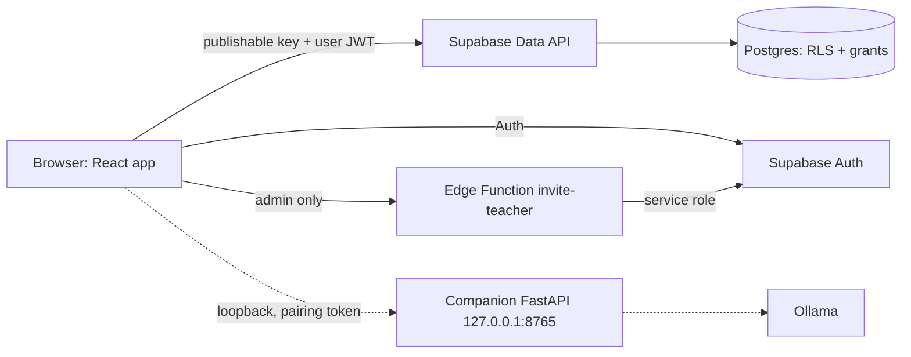

# FlashClass architecture (as built)

This implements [architecture-plan.md](architecture-plan.md). Every confirmed decision in
that plan still holds. This document covers how it was built and where the implementation
**improves on** the plan.



## 1. Database: the security boundary

Migrations live in `supabase/migrations`, in order:

| File | Contents |
|---|---|
| `…0100_foundation.sql` | private schema, locked default privileges, enums, `profiles`, `user_roles`, signup trigger, `teacher_directory` view, admin role RPCs |
| `…0200_materials.sql` | `subjects` taxonomy, `learning_materials`, `material_questions`, `app_private.question_answer_keys`, content and suitability validation, teacher write RPCs |
| `…0300_attempts_grading.sql` | `quiz_attempts`, `attempt_answers`, normalization, grading RPCs |
| `…0400_library_moderation.sql` | `saved_materials`, `material_reports`, `moderate_material`, `search_library` |

### Access model

- **Default deny.** `ALTER DEFAULT PRIVILEGES` revokes everything from `anon`/`authenticated`
  in `public`, so a new table or function is unreachable until a migration grants it on purpose.
  `anon` has no grants at all: the whole app requires sign-in.
- **Grants pick the operation, RLS picks the rows.**

| Table | `authenticated` can | Rows (RLS) |
|---|---|---|
| `profiles` | select; update `display_name`, `grade_preference`, `ui_locale` | own; admins read all |
| `user_roles` | select | own; admins read all |
| `subjects` | select | all |
| `learning_materials` | select, delete | owner; published+shared; admin. Delete: owner, not published/hidden |
| `material_questions` | select | exactly when the parent material is visible |
| `quiz_attempts`, `attempt_answers` | select | own only (no teacher or admin read in v1) |
| `saved_materials` | select, insert (`material_id`), delete | own; insert only for published items |
| `material_reports` | select, insert (`material_id, reason, details`), update (`status, resolution_note`) | reporter or admin; update admin only |
| `app_private.*` | nothing | not exposed by the API (`config.toml` → `api.schemas`) |

- **Roles are checked against the table, not JWT claims** (`app_private.has_role`), so revoking
  a role takes effect on the next request. Requested roles in signup metadata are ignored.

### Write path through RPCs (improvement)

The plan allowed teachers to write materials directly through the Data API, with RLS limiting
them to their own rows. As built, **materials, questions and attempts can't be written
directly at all.** Every write goes through one narrow function:

| RPC | Who | What |
|---|---|---|
| `save_material(jsonb)` | teacher | Creates or updates a material and its questions and answer keys in one transaction. Question ids stay stable. Validates every answer key. |
| `get_material_for_edit(id)` | owner | Editor payload, including answer keys. |
| `publish_material(id, attest)` | owner teacher | draft/archived → published. Requires the all-ages attestation, a suitability level and at least one item. |
| `unpublish_material(id)` | owner | published → archived |
| `moderate_material(id, 'hide'\|'restore', reason)` | admin | Hide closes the open reports. Restore returns the material to the teacher as archived, so the teacher must attest again. |
| `start_attempt(material_id)` | any user | Resumes the open attempt or creates one. |
| `submit_attempt(attempt_id, answers)` | attempt owner | Grades from the private keys. Rejects foreign or duplicate questions. Ignores forged score fields. |
| `get_attempt_result(attempt_id)` | attempt owner | Results. Answers are shown only if the material allows it. |
| `search_library(...)` | any user | `SECURITY INVOKER` (RLS applies). Ranks by text match, then closeness to the grade preference, then recency. Never filters by grade preference. |
| `admin_list_users`, `admin_set_role` | admin | Admins can't remove their own admin role. |
| `service_grant_role_by_email` | service_role only | Used by the invite Edge Function. |

Why: answer keys must live outside the exposed schema anyway, so teachers need an RPC to
write them. One atomic write path also removes a whole class of partial-save and RLS-policy
bugs, and keeps status changes and attestation in one audited place.

### Other improvements over the plan

- **Attempt history survives material deletion.** `quiz_attempts.material_id` is set to null
  on delete, and the title is copied onto the attempt.
- **A per-material "show answers after submit" switch.** Teachers can keep answer keys secret
  for practice tests where leakage matters.
- **A subject taxonomy table.** It holds Bulgarian school subjects plus non-school topics, and
  each subject sets its own scale (`grade`, `cefr` or `difficulty`). A trigger enforces the
  plan's rules: English uses CEFR only, other school subjects use one grade, and non-school
  topics use difficulty. Filters never use free text.
- **A content language tag** on every material, independent of the UI locale.
- **`ui_locale` stored in the profile.** A user's language choice follows them across devices.
- **Unicode-correct short-answer matching.** Answers are NFKC-normalized and case-folded with
  ICU, so Cyrillic works. Whitespace is collapsed and punctuation at either end is ignored.
  There is still no semantic matching; the UI states this limit to students.
- **Report de-duplication.** Each reporter can have only one open report per material
  (enforced by a partial unique index).
- **Teacher author names** come from `teacher_directory`. It shows teachers' display names
  only; student profiles are never exposed.

### Tests

`supabase/tests/*.test.sql` (pgTAP) cover allow and deny cases for profiles and roles,
materials and moderation, attempts and grading, and library, bookmarks and reports.

## 2. Web app (`web/`)

```text
src/
  app/          router, layout, session (Auth + current roles), route guards, static pages
  components/   Button, Field, Dialog (native <dialog>), alerts, badges, loaders
  domain/       pure, unit-tested logic: taxonomy, editor draft model, content schemas
  features/
    auth/       sign in/up, forgot/reset, email callback
    library/    home, library search, saved, material page, bookmarks, reports
    materials/  teacher list, editor (questions/cards/sections), publish flow
    quizzes/    take quiz, results, progress, flashcard review, study guide view
    ai/         companion client, generated-draft contract, generate panel
    admin/      reports, hidden materials, users & roles, invite teacher
    profile/    profile & grade preference
  i18n/         en (reference) + bg catalogs, typed keys, plural rules
  lib/          env validation, Supabase client, error mapping
  types/        database types (regenerate with `npm run db:types`)
```

- **Server state** lives in TanStack Query. It handles caching and invalidation; there is no
  global state library. Local workflows such as the editor and quiz answers use plain React state.
- **Every database error code maps to a translated message** (`lib/errors.ts`). Errors on a
  specific question, reported as `question:N`, highlight that question in the editor.
- **The editor saves through `save_material`, then reloads from the server**, so new question
  ids are always known and stay stable. It warns before you leave with unsaved changes.
  Publishing asks for the all-ages attestation in a dialog.
- **Quiz answers in progress are kept in `sessionStorage`** per attempt, so a reload doesn't
  lose them. Grading always happens on the server.
- **Teacher and admin pages load as separate code chunks.**
- **Secret-key guard:** the app refuses to start if the configured key is a secret or
  `service_role` key.
- **Accessibility basics are in place:** a skip link, labelled fields with described errors,
  native dialogs, and a role-based tablist. Text uses Inter Variable, which includes Cyrillic
  and is self-hosted, so no font CDN is involved.

## 3. Local AI companion (`companion/`)

FastAPI listens on `127.0.0.1` only (hard-coded). Endpoints: `GET /health`,
`GET /v1/models`, `POST /v1/generate`.

Security layers (`security.py`), each covered by tests:

1. **Loopback peers only.** The `Host` header must be `127.0.0.1:<port>` or `localhost:<port>`,
   which blocks DNS-rebinding attacks.
2. **Exact-match allowed origins.** CORS and Private Network Access preflights are answered
   only for those origins.
3. **A pairing token** (`/v1/*`), persisted per OS user and compared in constant time.
4. **Only GET and POST.** POST requires a `Content-Length` within the upload limit.
5. **Extraction runs in a worker thread with a timeout.** It accepts only `.pdf`, `.txt` and
   `.md`, checks magic bytes, and enforces page and character limits. Scanned PDFs are rejected
   because there is no OCR in v1. Files are never written to disk by the app, and contents are
   never logged.
6. **Source text is fenced** in the prompt as untrusted data.
7. **Model output is checked twice.** Ollama constrains it with a JSON schema, then Pydantic
   validates it, with one retry. The browser validates it again with Zod, and the user can only
   insert it into an unsaved draft.

**The shared contract stays in sync.** Both validators run against
`shared/fixtures/generated/*.json`, so the Python and TypeScript rules can't drift apart.

## 4. Known limits and next steps

- **Browser support for the companion.** Chrome and Edge handle HTTPS → `http://127.0.0.1`
  through Private Network Access preflights, and the client sends
  `targetAddressSpace: "local"`. Firefox treats loopback as potentially trustworthy. Safari
  blocks mixed content to loopback, so teachers must use Chrome, Edge or Firefox. Verify this
  on the real hosted origin before launch (see the operations checklist).
- **Editing a published quiz changes it live.** An attempt already in progress is graded
  against the current questions. A versioned snapshot of the material would fix this if it
  matters in practice.
- **Flashcard reviews are not recorded.** They run on the client only.
- **Classes, live rooms and leaderboards are deferred**, as the plan requires.
